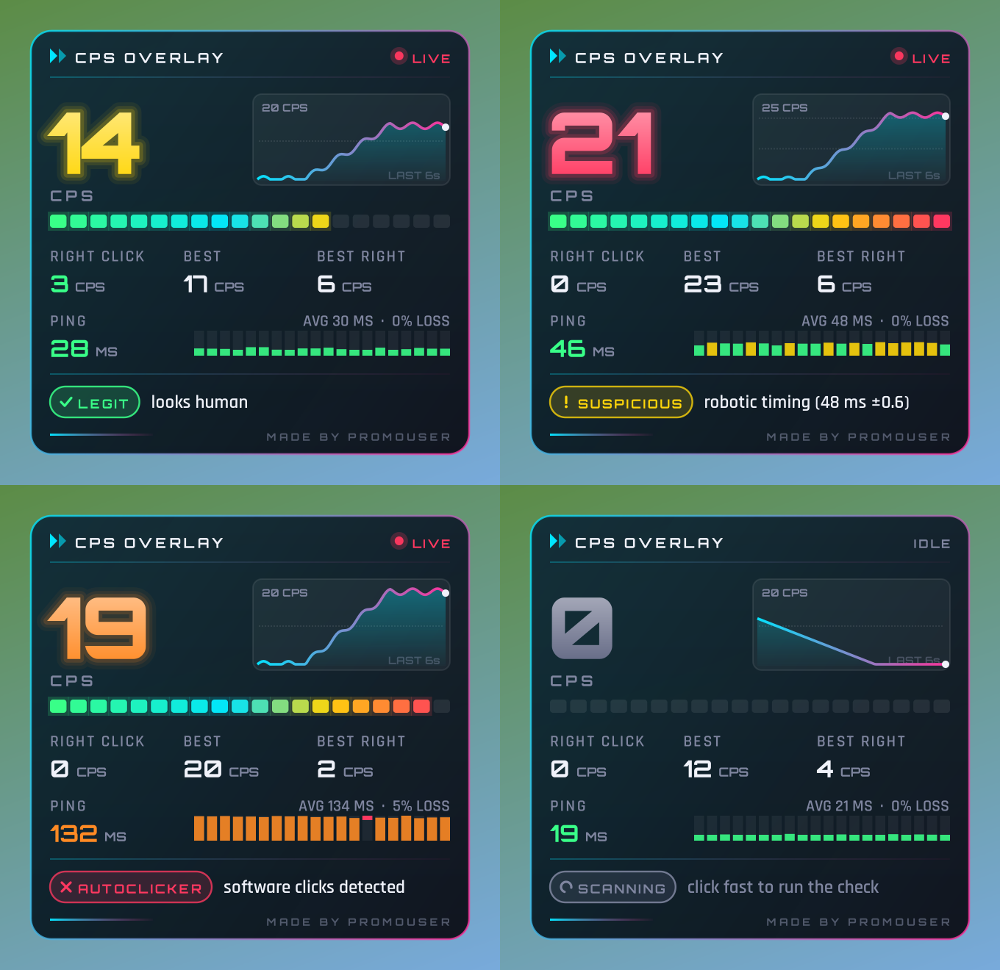

# CPS Overlay

Made by ProMouser.

A gaming-style overlay that sits on top of Minecraft (or any game) and shows:

- **Live CPS**: big neon number that climbs with every click and drops within a second of stopping, a 20-segment meter, and a graph of your last 6 seconds. Plus right-click CPS and your best for each.
- **Ping**: your ping in milliseconds with bars for the last 20 pings, the average, and how many were lost.
- **Autoclicker check**: whether your clicks come from a real mouse button or an autoclicker.



It runs on its own, outside Minecraft, so **the host doesn't need anything**. It only sees your own mouse, so it shows your CPS, not other players'.

## Run it

1. Download `CpsOverlay.exe`.
2. Double-click it. If Windows says "Windows protected your PC", click **More info → Run anyway** (it shows this for any program that isn't signed).
3. The overlay appears in the top-left corner. Mouse clicks go straight through it to the game.

If your browser blocks the `.exe`, download `CpsOverlay.zip` instead, right-click it, choose **Extract All**, and run the `.exe` inside.

Works on Windows 10 and 11 with nothing to install, and doesn't need admin rights. Some school computers only allow approved programs. If it won't open at all, that's why.

For the overlay to show over Minecraft, play in a window or in fullscreen with the window maximised. Most setups show it over fullscreen too.

## Options

Right-click the **CPS** icon next to the clock (it may be under the **^** arrow):

| Option | What it does |
|---|---|
| Show overlay | Hide or show the box (double-clicking the icon does the same) |
| Move overlay | Lets you drag the box. A moving yellow border shows it's movable. Click the option again to lock it, and it remembers the spot |
| Size | Small, Medium, Large or Extra large |
| Ping target | What to ping (see below) |
| Reset best CPS and checks | Starts your best scores and the autoclicker check over |
| Exit | Closes the overlay |

## Ping

Minecraft Education doesn't let other programs see who you're connected to, so the overlay pings an address you choose:

- **Your internet ping** (default): `1.1.1.1`. If this is high, everything online will lag.
- **Your ping to the host**: if the host is on the same network (for example the same school), ask them for their computer's IP address (on their computer: *Settings → Network & internet → Properties*, the "IPv4 address") and enter it as the ping target.

If the network blocks normal pings, the overlay times a web connection instead and shows "TCP" next to the number. That needs a target that's a website or a public server, such as `1.1.1.1`.

## Autoclicker check

| Shows | Meaning |
|---|---|
| **SCANNING** | Not enough fast clicks yet. Click at 4+ CPS for about 16 clicks |
| **LEGIT** | Your last burst of clicks passed every check |
| **SUSPICIOUS** | The clicks look machine-made (see the reason). Not proof on its own |
| **AUTOCLICKER** | A program made the clicks |

What it checks:

1. **Software clicks.** Clicks made by a program (almost every autoclicker) are marked by Windows as fake. A real mouse can't produce that mark. This is what shows **Autoclicker**.
2. **Timing too even.** People's clicks are never evenly spaced. Even very steady clickers wobble by several milliseconds, while autoclickers repeat within a millisecond or two.
3. **Instant release.** A finger holds the button for tens of milliseconds. Autoclickers often let go within a millisecond.
4. **Impossible speed.** Over 30 CPS.

Checks 2–4 can catch macro mice and hardware clickers that check 1 misses, so they show **Suspicious**. Drag clicking can also trigger 3 and 4, because it makes the button bounce very fast. Remote desktop, on-screen keyboards and some accessibility tools also make "software clicks".

A warning stays on screen for 10 seconds after the last suspicious click.

## Live CPS

The big number is how many times you clicked in the last second, which is how CPS is normally measured. The overlay redraws about 60 times a second, so it goes up the moment you click and counts down as soon as you stop, reaching 0 one second after your last click. The meter slides with it, and the number glows brighter on every click.

## Build from source

Needs the .NET SDK (6 or newer) on any OS:

```bash
dotnet build src -c Release      # -> src/bin/Release/net48/CpsOverlay.exe
dotnet run --project tests       # CPS and autoclicker-check tests
mono src/bin/Release/net48/CpsOverlay.exe --preview out   # draw sample frames to out/*.png (Linux/macOS)
```

The app targets .NET Framework 4.8, which comes with Windows 10 and 11, so the `.exe` runs without installing anything.

Fonts: [Orbitron](https://github.com/theleagueof/orbitron) and [Rajdhani](https://github.com/itfoundry/rajdhani), both under the SIL Open Font License (see `src/fonts`). They're built into the `.exe`. On Mono, the preview needs them installed on the system, because Mono can't draw fonts loaded from memory.
